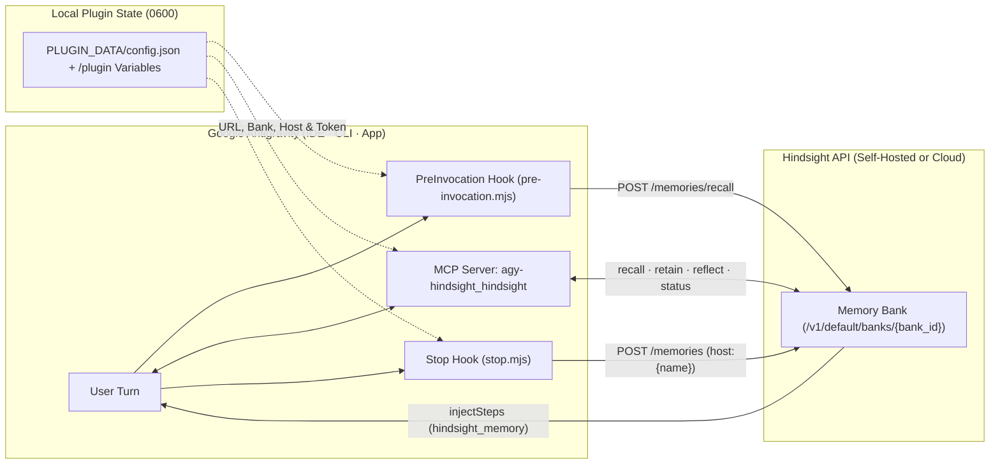

<div align="center">
  
  <h1>agy-hindsight</h1>
  <p>
    <strong>Persistent, cross-session <a href="https://github.com/vectorize-io/hindsight">Hindsight</a> long-term memory for Google Antigravity IDE, Antigravity CLI (<code>agy</code>), and Antigravity App.</strong>
  </p>
  <p>
    <a href="https://github.com/TechR10n/agy-hindsight/actions/workflows/ci.yml"></a>
    <a href="./CHANGELOG.md"></a>
    <a href="https://nodejs.org">= 20" /></a>
    <a href="./scripts"></a>
    <a href="./LICENSE"></a>
    <a href="./CONTRIBUTING.md"></a>
  </p>
  <p>
    <a href="#quickstart">Quickstart</a> ·
    <a href="#how-it-works">How It Works</a> ·
    <a href="#configuration">Configuration</a> ·
    <a href="#mcp-tools">MCP Tools</a> ·
    <a href="#project-structure">Project Structure</a> ·
    <a href="#troubleshooting">Troubleshooting</a> ·
    <a href="#contributing">Contributing</a>
  </p>
</div>

---

## Why `agy-hindsight`?

Every new coding-agent session starts with a blank slate—especially when you move between **Antigravity IDE** and **Antigravity CLI (`agy`)**. Architectural decisions, non-obvious root causes, and environment conventions get re-discovered from scratch.

`agy-hindsight` connects Antigravity directly to a **self-hosted** or **cloud** [Hindsight](https://github.com/vectorize-io/hindsight) memory bank using the official Antigravity plugin specification:

| Capability | What It Gives You |
| :--- | :--- |
| **Unified IDE + CLI + App Memory** | Shares one consistent memory bank across Antigravity IDE (`antigravity-ide`), Antigravity CLI (`antigravity-cli`), and Antigravity App. |
| **Automatic Turn Recall (`PreInvocation`)** | Queries your bank before each user turn and injects matching memories via `injectSteps` (`<hindsight_memory>`) without cluttering your prompt. |
| **Automatic Session Retention (`Stop`)** | Captures completed user/assistant turns at the end of a turn, stamped with `host:<name>` and `metadata.host` provenance. |
| **On-Demand MCP Tools (`stdio`)** | Exposes `hindsight_recall`, `hindsight_retain`, `hindsight_reflect`, and `hindsight_status` under `agy-hindsight_hindsight`. |
| **Built-In Memory Hygiene (`Rule + Skill`)** | Guides the agent to verify historical memories against live code, correct stale facts, and never retain secrets. |
| **Zero-Dependency Footprint** | Pure Node.js 20+ standard library (`fetch`, `node:fs`, `node:readline`) — no `node_modules` install step or supply-chain sprawl. |

---

## How It Works



---

## Quickstart

### Prerequisites

- **Node.js 20+** (`node -v`)
- **Antigravity CLI (`agy` 1.5+)** and/or **Antigravity IDE**

### 1. Start or Connect a Hindsight Backend

If you already run a Hindsight server and have a bank ID, skip to **Step 2**. Otherwise, pick either option:

<details open>
<summary><strong>Option A: Self-Hosted via Docker (Local, No Cloud Account Required)</strong></summary>

Follow the [Hindsight Quickstart](https://github.com/vectorize-io/hindsight) to launch Hindsight locally (API on `http://localhost:8888` and Control Plane UI on `http://localhost:9999`), then create a memory bank (for example, `dev-memory`) in the web UI or via `curl`:

```bash
curl -X PUT http://localhost:8888/v1/default/banks/dev-memory \
  -H "Content-Type: application/json" \
  -d '{}'
```

</details>

<details>
<summary><strong>Option B: Managed Hindsight Cloud</strong></summary>

1. Create a free account at [ui.hindsight.vectorize.io](https://ui.hindsight.vectorize.io).
2. Create a memory bank and copy its **Bank ID** and an **API Key**.
3. Use `https://api.hindsight.vectorize.io` as `HINDSIGHT_API_URL` in Step 3, and store your API key via `--api-token-stdin` so it never enters shell history.

</details>

### 2. Install `agy-hindsight`

```bash
# Install directly from GitHub
agy plugin install https://github.com/TechR10n/agy-hindsight

# Or install from a local clone
git clone https://github.com/TechR10n/agy-hindsight.git
agy plugin install ./agy-hindsight

# Confirm installation
agy plugin list
```

### 3. Configure & Enable

Open `/plugin` in `agy` CLI (or open the **Plugins** panel in Antigravity IDE), select **Hindsight**, and enter the two required settings:

- **`HINDSIGHT_API_URL`** — e.g. `http://localhost:8888` (self-hosted) or `https://api.hindsight.vectorize.io` (Cloud)
- **`HINDSIGHT_BANK_ID`** — e.g. `dev-memory`

*(Optional)* If your Hindsight server requires a Bearer token, pipe it from stdin into `0600` local plugin storage so secrets never touch shell history or Git:

```bash
# Example using 1Password CLI, Infisical, or interactive hidden input:
op read "op://Private/Hindsight/token" \
  | node ~/.gemini/config/plugins/agy-hindsight/scripts/configure.mjs --api-token-stdin
```

### 4. Verify Connection

```bash
node ~/.gemini/config/plugins/agy-hindsight/scripts/configure.mjs --status
```

Then start a session in Antigravity IDE or `agy` CLI and try one of the starter prompts:

- *"Check Hindsight connection health and active memory bank status"*
- *"Retain our key architectural decisions and findings into Hindsight"*
- *"Recall relevant Hindsight memories for the current task"*

---

## Configuration

### Required Plugin Variables

Declared in [`mcp_config.json`](./mcp_config.json) and shared automatically across the MCP server and lifecycle hooks (`PreInvocation` and `Stop`):

| Variable | Required | Default | Description |
| :--- | :---: | :---: | :--- |
| `HINDSIGHT_API_URL` | **Yes** | *(none)* | Base URL of your Hindsight API server (e.g. `http://localhost:8888`). |
| `HINDSIGHT_BANK_ID` | **Yes** | *(none)* | Target Hindsight memory bank ID for recall and retain (e.g. `my-memory-bank`). |

### Optional Settings & Environment Overrides

| Setting / Env Var | Required | Default | Description |
| :--- | :---: | :---: | :--- |
| `HINDSIGHT_API_TOKEN` | No | `""` (empty) | Optional Bearer token for authenticated servers. Leave empty when auth is disabled. |
| `HINDSIGHT_HOST_TAG` | No | Local short hostname | Computer identifier saved as tag `host:<name>` and `metadata.host = "<name>"`. |
| `HINDSIGHT_CREATE_BANK` | No | `false` | Opt-in (`true`/`false`) to `PUT /v1/default/banks/<bank>` with `{}` if missing. Never overwrites existing bank settings. |
| `AGY_HINDSIGHT_DISABLED` | No | `false` | Set to `1` or `true` to pause hooks and MCP calls for a single shell command. |

### CLI Configuration Helper (`scripts/configure.mjs`)

`configure.mjs` manages optional settings in `${PLUGIN_DATA}/config.json` (`0600` permissions) and keeps **Antigravity IDE** and **Antigravity CLI** `PLUGIN_DATA` directories synchronized:

```bash
# View redacted configuration status (never prints token values)
node ~/.gemini/config/plugins/agy-hindsight/scripts/configure.mjs --status

# Set a custom machine identifier (stamped as host:workstation and metadata.host="workstation")
node ~/.gemini/config/plugins/agy-hindsight/scripts/configure.mjs --host-tag workstation

# Store an API token safely via stdin (Infisical example)
infisical secrets get HINDSIGHT_API_KEY --env prod --plain \
  | node ~/.gemini/config/plugins/agy-hindsight/scripts/configure.mjs --api-token-stdin

# Remove a stored token (for unauthenticated local servers)
node ~/.gemini/config/plugins/agy-hindsight/scripts/configure.mjs --clear-token

# Temporarily pause or resume the plugin globally
node ~/.gemini/config/plugins/agy-hindsight/scripts/configure.mjs --disable
node ~/.gemini/config/plugins/agy-hindsight/scripts/configure.mjs --enable
```

---

## MCP Tools

When enabled, Antigravity namespaces the bundled stdio server as `agy-hindsight_hindsight`:

| Tool | Mode | Key Parameters | Purpose |
| :--- | :---: | :--- | :--- |
| `hindsight_recall` | Read-only | `query` *(req)*, `budget` (`low`\|`mid`\|`high`), `max_tokens`, `types`, `tags`, `tags_match`, `prefer_observations` | Search your memory bank for relevant facts (`world`, `experience`, `observation`) mid-session. |
| `hindsight_retain` | Write | `content` *(req)*, `context`, `document_id`, `tags`, `metadata`, `async` (`false` default) | Immediately persist high-signal decisions or root causes with `host:<name>` provenance. |
| `hindsight_reflect` | Read-only | `query` *(req)*, `context`, `budget` (`low` default), `max_tokens`, `tags`, `tags_match` | Synthesize a grounded answer across multiple stored memories (timelines, trade-offs, summaries). |
| `hindsight_status` | Read-only | *(none)* | Report server version, bank statistics, detected surface (`antigravity-ide` / `antigravity-cli`), and redacted config status. |

---

## Safety Guarantees & Design Boundaries

- **Strictly Memory (No OTLP / No Proxy):** Communicates exclusively with Hindsight's REST API (`/version` and `/v1/default/banks/...`). It is **not** an OpenTelemetry trace collector and never proxies or intercepts Antigravity model calls.
- **No Hard-Coded Defaults:** Missing `HINDSIGHT_API_URL` or `HINDSIGHT_BANK_ID` fails with an explicit setup message rather than silently pointing to a default host or bank.
- **Shared-Bank Safe by Default:** Never creates per-repo banks (`dynamicBankId: false`, `createBank: false`) and never alters bank missions or settings (`manageBankConfig: false`).
- **Preserved Host Attribution:** Every retained turn and `hindsight_retain` item stamps `host:<name>` and `metadata.host`, while stripping reserved `harness:` and `source:` prefixes so host provenance is never discarded.
- **Fail-Open Hooks:** If your Hindsight server is offline or unreachable, `PreInvocation` and `Stop` exit cleanly with `{}` so your coding session is never blocked.

---

## Project Structure

```text
agy-hindsight/
├── plugin.json                        # Antigravity plugin manifest & Marketplace metadata
├── hooks.json                         # PreInvocation (recall) and Stop (retain) hook bindings
├── mcp_config.json                    # Bundled stdio MCP server + required user variables
├── assets/
│   └── logo.svg                       # 128x128 plugin icon (light/dark surface safe)
├── rules/
│   └── AGENTS.md                      # Always-on memory verification & secret-safety guardrails
├── skills/
│   └── hindsight-memory/
│       └── SKILL.md                   # On-demand troubleshooting, recall, retain & reflect skill
├── scripts/
│   ├── pre-invocation.mjs             # PreInvocation hook -> Hindsight recall -> injectSteps
│   ├── stop.mjs                       # Stop hook -> IDE/CLI transcript parser -> Hindsight retain
│   ├── mcp-server.mjs                 # Zero-dependency JSON-RPC stdio MCP server (4 tools)
│   ├── configure.mjs                  # CLI helper for 0600 PLUGIN_DATA settings & stdin tokens
│   ├── self-test.mjs                  # Offline unit + mock-HTTP integration suite (9 suites)
│   └── lib/
│       ├── client.mjs                 # Hindsight v1 REST client with configurable timeouts
│       ├── config.mjs                 # Unified IDE + CLI config resolution & secret redaction
│       ├── stamp.mjs                  # host:<name> tag & metadata.host sanitizer
│       └── transcript.mjs             # Antigravity IDE (.jsonl) & CLI turn extractor
├── docs/
│   ├── verification-proof.md          # End-to-end strict validation & IDE/CLI UAT evidence
│   └── marketplace-readiness.md       # Release & Marketplace submission checklist
└── .github/
    ├── workflows/ci.yml               # Automated Node 20/22 self-test & manifest CI checks
    ├── ISSUE_TEMPLATE/                # Bug report & feature request forms
    └── PULL_REQUEST_TEMPLATE.md       # Contributor verification checklist
```

---

## Troubleshooting

<details>
<summary><strong>The plugin shows as disabled right after <code>agy plugin install</code></strong></summary>

Antigravity leaves plugins that declare required MCP `variables` disabled until those variables are provided. Open `/plugin` in `agy` CLI (or the Plugins view in Antigravity IDE), select **Hindsight**, enter `HINDSIGHT_API_URL` and `HINDSIGHT_BANK_ID`, and enable the plugin.

</details>

<details>
<summary><strong><code>agy plugin validate</code> or <code>agy plugin install</code> says unknown subcommand</strong></summary>

Check `which -a agy` and `agy --version`. Older standalone binaries earlier on your `PATH` (for example `~/.local/bin/agy` `< 1.5`) can shadow `~/.gemini/bin/agy`. Prepend `export PATH="$HOME/.gemini/bin:$PATH"` in your shell profile.

</details>

<details>
<summary><strong><code>hindsight_reflect</code> takes longer on a self-hosted local LLM</strong></summary>

Reflection synthesizes across retrieved memories using the LLM configured on your Hindsight server. `agy-hindsight` defaults `hindsight_reflect` to `budget: "low"` with a `150s` client timeout so local/self-hosted inference completes reliably; pass `budget: "mid"` or `"high"` when you want deeper multi-hop synthesis.

</details>

<details>
<summary><strong>How do I pause memory capture for one sensitive command?</strong></summary>

Prefix a CLI command with `AGY_HINDSIGHT_DISABLED=1 agy ...`, or toggle `--disable` / `--enable` via `scripts/configure.mjs`.

</details>

---

## Contributing

Contributions, bug reports, self-hosted deployment tips, and skill improvements are very welcome!

### Quick Contributor Workflow

```bash
# 1. Clone and create a feature branch
git clone https://github.com/TechR10n/agy-hindsight.git
cd agy-hindsight
git checkout -b feat/my-improvement

# 2. Run the zero-network test suite (9 suites)
node ./scripts/self-test.mjs

# 3. Run strict Antigravity plugin validation (must report 0 errors, 0 warnings)
agy plugin validate --strict .
```

### Ways to Get Involved

- **Ask questions & share workflows:** Open a thread in [GitHub Discussions](https://github.com/TechR10n/agy-hindsight/discussions) (bank organization patterns, local LLM setups, custom rules).
- **Report bugs or request enhancements:** Use the structured [Issue Forms](https://github.com/TechR10n/agy-hindsight/issues/new/choose) (please redact tokens and private URLs).
- **Submit Pull Requests:** Read [**CONTRIBUTING.md**](./CONTRIBUTING.md) for our five core invariants (memory-only scope, zero npm dependencies, no hard-coded defaults, shared-bank safety, and `host:<name>` provenance) and PR checklist.

### Project Docs & Policies

- [Contributor Guide (`CONTRIBUTING.md`)](./CONTRIBUTING.md)
- [Verification & UAT Proof (`docs/verification-proof.md`)](./docs/verification-proof.md)
- [Marketplace Readiness (`docs/marketplace-readiness.md`)](./docs/marketplace-readiness.md)
- [Security Policy (`SECURITY.md`)](./SECURITY.md)
- [Changelog (`CHANGELOG.md`)](./CHANGELOG.md)

---

## License

Released under the [MIT License](./LICENSE).
